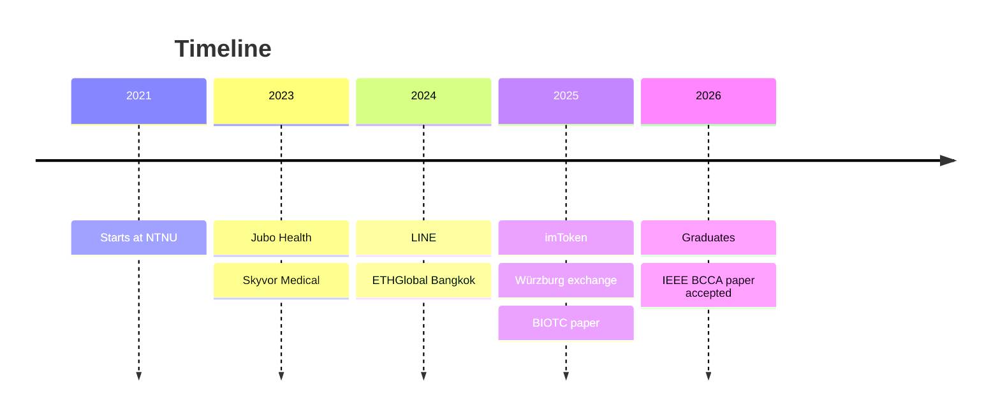

  

  <a href="mailto:patrick.celee@gmail.com">Email</a> &nbsp;·&nbsp;
  <a href="https://www.linkedin.com/in/patrick-lee-1852b6226">LinkedIn</a>

> [!NOTE]
> Fresh NTNU grad, looking for **backend / Web3 engineering** roles. If you're hiring, or just want to talk shop, say hi.

## About

I'm Patrick (Chen En on paper). I graduated from National Taiwan Normal University in June 2026, did an exchange at the University of Würzburg in Germany, and somewhere along the way ended up writing Kafka pipelines at LINE and Solidity contracts at imToken.

I like backend problems where you can actually measure the improvement. I've also become a bit hooked on Web3, because designing for "nobody has to trust anybody" is a surprisingly fun constraint.

## The route so far

## What I've built

<b>imToken</b> · engineering intern · 2025–26 &nbsp;·&nbsp; <i>one transaction, thousands of recipients</i>

 

- Led delivery of *Claimable Link V3*, a Solidity voucher contract on multiple EVM L2s that sends assets to thousands of recipients in a single transaction.
- Built the Merkle tree verification stack behind it (leaf encoding, off-chain proofs, on-chain root validation), and researched cross-chain protocols and the Ethereum Interop Layer along the way.

<b>LINE</b> · software engineering intern · 2024–25 &nbsp;·&nbsp; <i>-87% p95 latency on a speech-to-text pipeline</i>

 

- Looked after the LINE fact-checker service (Spring Boot, Vue.js, Elasticsearch, Redis, Kafka).
- Wrote an MPEG audio parser from scratch for a speech-to-text feature, then moved the pipeline to async Kafka workflows: **-58%** mean request time, **-87%** p95 latency.
- Moved the project from Java 8 to 17 and upgraded the webhook server to the latest LINE Messaging API: **-60%** CPU usage.

<b>Jubo Health</b> · engineering intern · 2023 &nbsp;·&nbsp; <i>-73% evaluation run time</i>

 

- Led a small intern team building a React portal for long-term care facility self-evaluations, plus a FastAPI backend on Azure.
- Caching and async processing cut evaluation run time by **73%**.

<b>Skyvor Medical</b> · remote software engineering intern · 2023–24 &nbsp;·&nbsp; <i>0% to 83% test coverage</i>

 

- Built ASP.NET APIs for an electronic data capture system, with xUnit tests taking coverage from **0% to 83%**.

## Research and hackathons

- **XMTP Prize, ETHGlobal Bangkok 2024** for *Xentinel Agent*, a tool for multisig operations and post-deployment monitoring.
- **1st place (High Distinction), NTNU capstone exhibition**, which turned into a first-author paper: *Blockchain Applications in Carbon Credit Fraud Detection* (BIOTC '25, ACM).
- **IEEE BCCA 2026 (accepted):** *Repairing the Verification Gap in the Ethereum Interop Layer SDK: Reproducible Validation of Voucher-Based L2 Interoperability*.

## Toolbox

**Backend** &nbsp; `Java` `Spring Boot` `Python` `FastAPI` `C#` `ASP.NET` `Node.js`  
**Web3** &nbsp; `Solidity` `EVM L2s` `Merkle proofs` `Ethereum Interop Layer`  
**Data** &nbsp; `Kafka` `Elasticsearch` `Redis` `PostgreSQL` `MySQL`  
**Infra** &nbsp; `Docker` `Nginx` `Azure` `AWS` `git`  
**Frontend** &nbsp; `React` `Vue.js` `JavaScript`

## Off the clock

  

I played winger in high school, and I backpacked solo through 16 countries while living in Germany. Happy to trade travel stories, or argue about tyre strategy.

---

  <picture>
    <source media="(prefers-color-scheme: dark)" srcset="https://github-profile-summary-cards.vercel.app/api/cards/stats?username=patty111&theme=github_dark">
    
  </picture>
  <picture>
    <source media="(prefers-color-scheme: dark)" srcset="https://github-profile-summary-cards.vercel.app/api/cards/most-commit-language?username=patty111&theme=github_dark">
    
  </picture>

<!--
Optional: contribution snake. Add .github/workflows/snake.yml, run it once from the Actions tab,
then delete this comment wrapper.

  <picture>
    <source media="(prefers-color-scheme: dark)" srcset="https://raw.githubusercontent.com/patty111/patty111/output/github-contribution-grid-snake-dark.svg">
    
  </picture>

-->
